## CRUSH4SQL
Mayank Kothyari, Dhruva Dhingra, Sunita Sarawagi, Soumen Chakrabarti.
[Collective Retrieval Using Schema Hallucination For Text2SQL](https://arxiv.org/abs/2311.01173). *EMNLP 2023*

## About CRUSH4SQL
*CRUSH* leverages LLM hallucination (generally considered a nuisance) in conjunction with dense retrieval, to identify a small, high-recall subset of schema elements for a downstream Text-to-SQL stage.

## Demo
You can try out our demo for SocialDB by running the [CRUSH_demo.ipynb](demo/CRUSH_demo.ipynb) notebook.

## SocialDB dataset
You can access the dataset at `data/SocialDB`.

- `ndap_queries.json` contains the all queries with their corresponding gold tables.
- `ndap_super.json` contains all the tables in the dataset. Each table has the following information:
    - `code`: unique identifier for the table
    - `name`: name of the table
    - `overview`: description of the table's contents and purpose
    - `source`: domain the table belongs to (e.g., agriculture, finance, etc.)
    - `columns`: columns in the table
